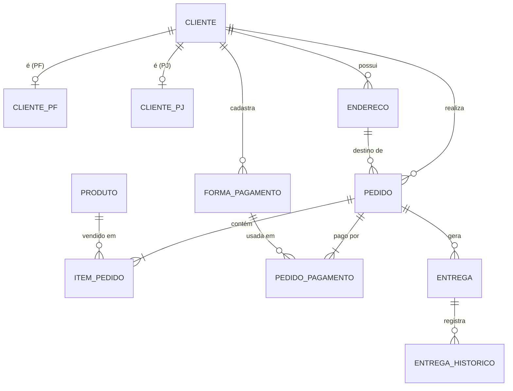

# 🛒 Modelagem de Banco de Dados — E-commerce.

Projeto de refinamento do modelo conceitual/lógico de um e-commerce, desenvolvido como desafio de projeto da DIO.

## Objetivo

Partindo do modelo base de e-commerce (clientes, produtos, pedidos), foram acrescentados três requisitos:

| Requisito | Como foi resolvido |
|---|---|
| **Cliente PF e PJ** — uma conta é PF *ou* PJ, nunca as duas | Supertipo `cliente` + subtipos `cliente_pf` e `cliente_pj` (especialização **disjunta**) |
| **Pagamento** — mais de uma forma cadastrada | Tabela `forma_pagamento` (1 cliente : N formas) + `pedido_pagamento` (um pedido pode ser pago com várias formas) |
| **Entrega** — status e código de rastreio | Tabela `entrega` com `status_entrega` e `codigo_rastreio`, mais `entrega_historico` para a linha do tempo |

## Diagrama (EER simplificado)



## Decisões de modelagem

1. **PF × PJ exclusivo no próprio banco.** A tabela `cliente` guarda um discriminador `tipo_cliente` ('PF'/'PJ'). Cada subtipo tem uma FK composta `(id_cliente, tipo_cliente)` e um `CHECK` fixando o seu tipo. Assim, um cliente PF não consegue receber linha em `cliente_pj` (e vice-versa), sem depender da aplicação.
   - *Limitação conhecida:* o banco não obriga que todo cliente PF **tenha** uma linha em `cliente_pf`. Isso deve ser garantido inserindo `cliente` + subtipo na mesma transação.
2. **Várias formas de pagamento.** `forma_pagamento` guarda só dados não sensíveis (bandeira, 4 últimos dígitos, chave Pix). Número completo e CVV **não** são armazenados — isso fica com o gateway de pagamento.
3. **Pagamento dividido.** `pedido_pagamento` liga pedido ↔ forma de pagamento com valor, parcelas e status. FKs compostas garantem que a forma de pagamento e o endereço usados pertencem ao **mesmo cliente** do pedido.
4. **Entrega rastreável.** `codigo_rastreio` é `UNIQUE` e opcional enquanto o pedido está em separação; um `CHECK` o torna obrigatório a partir de `POSTADO`. O histórico fica em `entrega_historico`.
5. **Preço congelado.** `item_pedido.preco_unitario` guarda o valor da época da compra, para o histórico não mudar quando o preço do produto mudar.

## Como executar

Requer **MySQL 8.0.16+** (necessário para o `CHECK` ser aplicado).

```bash
mysql -u root -p < ecommerce-schema.sql
```

O script cria o banco, as tabelas, insere dados de exemplo e inclui consultas de validação. Ao final há um teste (comentado) que **deve falhar**, provando a regra PF × PJ.

## Estrutura do repositório

```
├── README.md
└── ecommerce-schema.sql
```

## Próximos passos possíveis

- Tabelas de `fornecedor`, `vendedor_terceiro` e `estoque` por local.
- *Trigger* ou procedure para criar cliente + subtipo atomicamente.
- Exportar o diagrama do MySQL Workbench (`.mwb`/imagem) para a pasta `/images`.
